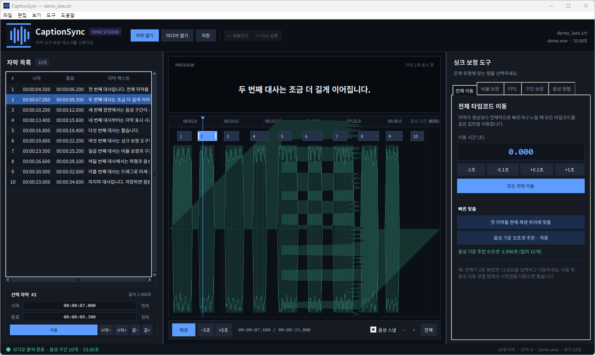

# CaptionSync

**자막 싱크를 다섯 가지 방식으로 고치는 Windows 데스크톱 스튜디오**



자막이 통째로 밀리거나, 뒤로 갈수록 벌어지거나, 특정 장면부터 어긋나는 문제를
파형·음성 구간과 함께 눈으로 확인하며 보정합니다. 모든 작업은 되돌릴 수 있고,
원본 파일의 형식과 인코딩을 최대한 그대로 유지해 저장합니다.

- Windows 10/11 데스크톱 앱 (Tkinter)
- Python 표준 라이브러리만 사용 — 추가 설치 없음
- SRT · WebVTT · ASS/SSA 읽기/쓰기
- 파형 타임라인에서 드래그·스냅·확대/축소
- 음성 구간(VAD) 기반 자동 정렬과 오프셋 추천
- 영상과 자막을 모두 열면 실행되는 **원클릭 자동 싱크**
- 영상만 열어도 로컬 Whisper로 **한국어 자막 생성** 가능

---

## 다섯 가지 문제, 다섯 가지 해결책

| 증상 | CaptionSync의 해결 방법 | 화면 |
| --- | --- | --- |
| 전체가 3초 정도 빠르거나 느리다 | **전체 이동** — 모든 자막을 같은 시간만큼 이동 | `전체 이동` 탭 |
| 앞은 맞는데 뒤로 갈수록 점점 벌어진다 | **비율·드리프트 보정** — 실제로 맞는 두 지점(A/B)을 지정해 선형 변환 | `비율 보정` 탭 |
| 특정 장면부터 자막이 통째로 틀어진다 | **구간 보정** — N번째 자막부터, 특정 시각부터, 또는 선택 구간만 이동 | `구간 보정` 탭 |
| 자막마다 표시 시간이 조금씩 부정확하다 | **음성 구간 자동 정렬** — 발화 시작·끝에 자막 경계를 스냅 | `음성 정렬` 탭 |
| 23.976 ↔ 25처럼 FPS가 다르다 | **FPS 보정** — 프레임레이트 비율로 타임코드 전체 변환 | `FPS` 탭 |

### 1. 전체 이동
- 이동 시간을 초 단위로 입력하거나 `-1초`, `-0.1초`, `+0.1초`, `+1초` 버튼을 사용합니다.
- 음성을 먼저 열어 두면 **음성 기준 오프셋 추천**이 현재 자막과 발화 시작점을
  비교해 가장 일관된 이동값을 찾아 줍니다. (예: 전체가 3초 늦으면 `-2.99초`)
- 추천값은 한 번에 적용할 수 있고, 적용 전에 미리보기로 확인할 수 있습니다.

### 2. 비율 · 드리프트 보정
- 자막의 두 지점과 그 지점이 실제로 나와야 하는 영상을 짝지어 입력합니다.
- 두 기준점 사이를 선형 보간해 **모든 자막의 시작·끝과 길이를 비율에 맞게** 조정합니다.
- 2시간짜리 영상의 PAL 속도 변환처럼 일정 비율로 벌어지는 문제에 적합합니다.

### 3. 구간 보정
- `N번째 자막부터 전체` — 선택한 자막과 그 뒤의 모든 자막을 이동
- `시작 시각부터 전체` — 지정한 시각 이후에 시작하는 자막만 이동
- `선택 구간` — 시작/끝 자막 번호를 지정해 그 구간만 이동
- 타임라인에서 자막을 클릭해 기준 위치를 잡을 수도 있습니다.

### 4. 음성 구간 자동 정렬
- 미디어를 열면 파형을 분석해 **발화 구간을 자동 검출**합니다.
- 각 자막의 시작을 가장 가까운 발화 시작점에, 끝을 발화 끝점에 맞춥니다.
- `전체` 또는 `선택 자막`만 정렬할 수 있고, 탐색 범위(기본 1.5초)를 조절할 수 있습니다.
- 너무 멀리 떨어진 자막은 건너뛰고 결과를 알려 주므로 엉뚱한 곳으로 튀지 않습니다.

### 5. FPS 보정
- 자막 기준 FPS와 실제 영상 FPS를 선택합니다. (23.976 / 24 / 25 / 29.97 / 30 / 48 / 50 / 59.94 / 60)
- `23.976 → 25`, `25 → 23.976` 등의 프리셋과 두 값을 바꾸는 `⇄` 버튼을 제공합니다.
- 첫 자막 위치를 기준점(anchor)으로 삼아 앞부분은 그대로 두고 뒤로 갈수록
  커지는 오차를 비율로 보정할 수 있습니다.

---

## 원클릭 자동 싱크

자막과 영상/오디오를 열면 CaptionSync가 음성 구간을 분석하고 자동 싱크를
계산합니다. 신뢰도가 높은 결과는 바로 적용되며, 낮은 결과는 적용 전에 확인을
요청합니다. `Ctrl+Shift+A` 또는 상단 **자동 싱크** 버튼으로 다시 실행할 수도
있습니다. 모든 자동 보정은 하나의 작업으로 기록되므로 `Ctrl+Z`로 되돌릴 수
있습니다.

자동 엔진은 전체 이동, 일정한 드리프트와 FPS 비율, 장면별 오프셋, 자막별
표시 시간 오차를 순서대로 판단하고, 단조 매칭과 발화 시작·끝 스냅을 사용합니다.
오디오가 없거나 배경음이 큰 경우에는 결과 신뢰도가 낮아질 수 있습니다.

## 영상에서 한국어 자막 만들기

자막 없이 영상만 연 뒤 상단 **한글 자막 생성**을 누르면 음성을 인식해 새 SRT
문서를 만듭니다. 음성인식은 선택 기능이며 오디오를 외부 서버로 전송하지 않고
로컬 Whisper를 사용합니다.

```bat
pip install faster-whisper
```

첫 실행 때 Whisper 모델이 다운로드됩니다. `small` 모델은 속도와 한국어 인식
정확도의 균형이 좋으며, GPU가 있으면 더 빠르게 처리됩니다. 생성된 자막은
메모리에 열린 상태이므로 **다른 이름으로 저장**하여 보관하세요.

## 빠른 시작

1. [Python 3.10+](https://www.python.org/downloads/windows/)를 설치합니다.
   (공식 설치 프로그램에 Tkinter가 포함되어 있습니다.)
2. 저장소를 내려받고 `run.bat`을 실행하거나, 폴더에서 아래 명령을 실행합니다.

```bat
python -m captionsync
```

3. **자막 열기**(`Ctrl+O`)로 자막 파일을, **미디어 열기**(`Ctrl+Shift+O`)로
   영상/오디오를 엽니다.
4. 자동 싱크 결과를 확인합니다. 필요할 때만 오른쪽 **싱크 보정 도구**를 사용합니다.
5. `Ctrl+S`로 저장합니다. 필요하면 `Ctrl+Shift+S`로 다른 이름에 저장합니다.

### 예제로 바로 체험하기

`examples/` 폴더에 데모 오디오와 일부러 어긋난 자막이 들어 있습니다.

```bat
python -m captionsync examples\demo_late.srt examples\demo.wav
```

- `demo_late.srt`: 전체가 약 3초 늦은 자막 → **음성 기준 오프셋 추천**이 `-2.99초`를 제안
- `demo_jitter.srt`: 줄마다 조금씩 어긋난 자막 → **음성 구간 자동 정렬**로 10개 자막 정렬

데모 파일을 다시 만들려면:

```bat
python tools\make_demo.py
```

---

## 화면 구성

- **자막 목록** — 시작/종료/텍스트를 표로 확인합니다. 시간 셀을 더블클릭하면
  직접 수정할 수 있고, 행을 선택하면 타임라인과 미리보기가 함께 따라갑니다.
- **PREVIEW** — 재생 위치에 표시되는 자막을 실제 자막처럼 보여 줍니다.
- **타임라인** — 파형, 발화 구간(초록 음영), 자막 바를 한 화면에 보여 줍니다.
  - 빈 곳 클릭: 재생 위치 이동
  - 자막 바 드래그: 이동 / 양끝 핸들 드래그: 시작·끝 조정
  - 마우스 휠: 확대·축소, 가운데 버튼 드래그: 화면 이동
  - `스냅`이 켜져 있으면 발화 시작·끝에 자동으로 붙습니다.
- **선택 자막** — 선택한 자막의 시작·종료를 직접 입력하거나 0.1초 단위로 미세 조정합니다.
- **싱크 보정 도구** — 다섯 가지 보정 탭과 음성 분석 상태를 제공합니다.
- **상태 표시줄** — 현재 파일, 인코딩, 미디어 길이, 분석 결과를 보여 줍니다.

---

## 지원 형식과 인코딩

| 항목 | 지원 내용 |
| --- | --- |
| 자막 | `.srt`, `.vtt` / `.webvtt`, `.ass` / `.ssa` |
| 인코딩 | UTF-8, UTF-8 BOM, UTF-16, CP949 자동 감지 |
| 저장 | 원본 인코딩 유지, 실패 시 UTF-8로 저장 |
| 오디오 분석 | PCM WAV는 기본 지원, 그 외 형식은 FFmpeg로 변환 후 분석 |
| 재생 | Windows MCI로 재생, 실패 시 가상 시계로 동작 |

> ASS/SSA는 Dialogue 라인의 스타일·여백 등 기존 필드를 보존하고,
> 자막 텍스트와 시간만 수정합니다.

### FFmpeg (선택 사항)

- WAV 파일만 사용한다면 FFmpeg가 없어도 됩니다.
- MP4, MKV, MP3, AAC 등에서 음성 구간을 분석하려면 FFmpeg가 필요합니다.
- `PATH`에 있으면 자동 감지하고, 없으면 **도구 → FFmpeg 경로 지정…**에서
  `ffmpeg.exe` 위치를 선택할 수 있습니다. 설정은 다음 실행에도 유지됩니다.

---

## 단축키

| 단축키 | 동작 |
| --- | --- |
| `Ctrl+O` | 자막 열기 |
| `Ctrl+Shift+O` | 미디어 열기 |
| `Ctrl+S` | 저장 |
| `Ctrl+Shift+S` | 다른 이름으로 저장 |
| `Ctrl+Z` / `Ctrl+Y` | 되돌리기 / 다시 실행 |
| `Space` | 재생 / 일시정지 |
| `←` / `→` | 1초 이동 |
| `Shift+←` / `Shift+→` | 0.1초 이동 |
| `Ctrl+←` / `Ctrl+→` | 10초 이동 |
| `Alt+←` / `Alt+→` | 선택 자막 0.05초 이동 |
| `Alt+Shift+←/→` | 선택 자막 시작만 0.05초 이동 |
| `Alt+Ctrl+←/→` | 선택 자막 끝만 0.05초 이동 |
| `Delete` | 선택 자막 삭제 |
| `Ctrl+0` | 타임라인 전체 보기 |
| `Ctrl++` / `Ctrl+-` | 타임라인 확대 / 축소 |
| `Home` | 처음으로 이동 |
| `Esc` | 재생 정지 |
| `F1` | 사용법 |

---

## 실행 환경과 테스트

- **OS**: Windows 10/11
- **Python**: 3.10 이상 (개발·검증 환경: 3.15)
- **외부 패키지**: 없음 (표준 라이브러리 + Tkinter + Windows `winmm.dll`)

단위 테스트:

```bat
python -m unittest discover -s tests -v
```

테스트는 타임코드 파싱, SRT/VTT/ASS 왕복 변환, 인코딩 감지, 다섯 가지 보정
알고리즘, 실행 취소/다시 실행, WAV 분석과 음성 구간 검출을 다룹니다.

---

## 프로젝트 구조

```text
CaptionSync/
├─ captionsync/
│  ├─ app.py            # 진입점, 화면 크기/명령줄 처리
│  ├─ audio.py          # WAV 파형, 적응형 VAD, FFmpeg 변환
│  ├─ config.py         # %APPDATA%\CaptionSync\config.json
│  ├─ formats.py        # SRT/VTT/ASS 파싱·직렬화·인코딩
│  ├─ models.py         # Cue/Document, 실행 취소 기록
│  ├─ player.py         # Windows MCI 재생 + 가상 시계
│  ├─ timecode.py       # 타임코드 파싱/포맷
│  ├─ transforms.py     # 다섯 가지 보정 알고리즘
│  └─ ui/
│     ├─ main_window.py # 메인 창과 워크플로 연결
│     ├─ timeline.py    # 파형·발화 구간·자막 타임라인
│     ├─ cue_table.py   # 자막 목록과 인라인 시간 편집
│     ├─ tools_panel.py # 전체 이동/비율/FPS/구간/음성 정렬
│     ├─ theme.py       # 다크 테마와 글꼴
│     └─ widgets.py     # 버튼, 입력 필드, 툴팁, 아이콘
├─ examples/            # 데모 WAV + 어긋난 자막 2종
├─ tests/test_core.py   # 단위 테스트 25개
├─ tools/make_demo.py   # 데모 파일 생성기
├─ run.bat              # 더블클릭 실행
└─ assets/screenshot.png
```

---

## 라이선스

[MIT License](LICENSE)
